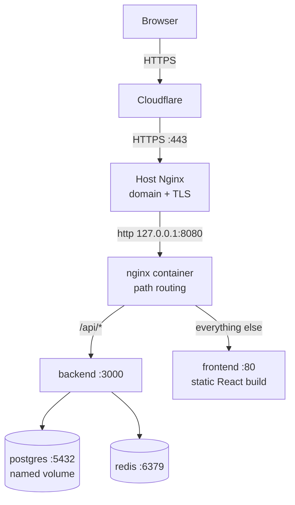
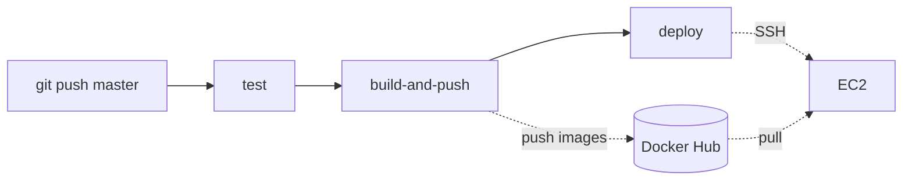

# Patron Arts

A full-stack e-commerce store for handmade carpets, containerized with Docker and deployed to AWS EC2 through a GitHub Actions CI/CD pipeline.

**Live:** https://kashmiriart.azanabbaswani.online

Every push to `master` is tested, built into Docker images, published to Docker Hub, and deployed to the server automatically. No manual step sits between a commit and the live site.

## Contents

- [Stack](#stack)
- [Architecture](#architecture)
- [CI/CD pipeline](#cicd-pipeline)
- [Repository layout](#repository-layout)
- [Configuration and secrets](#configuration-and-secrets)
- [Running locally](#running-locally)
- [Server setup (one time)](#server-setup-one-time)
- [Nginx and HTTPS](#nginx-and-https)
- [Operations runbook](#operations-runbook)
- [Application design](#application-design)
- [Known limitations](#known-limitations)

## Stack

| Layer | Technology |
| --- | --- |
| Frontend | React 19, Vite, React Router, served by nginx |
| Backend | Node.js 20, Express 5, JWT auth, bcrypt, zod |
| Database | PostgreSQL 18 |
| Cache | Redis 8 (connected, reserved for caching) |
| Containers | Docker, Docker Compose |
| CI/CD | GitHub Actions |
| Image registry | Docker Hub (`arexali777/patron-backend`, `arexali777/patron-frontend`, public) |
| Hosting | AWS EC2, Ubuntu, Elastic IP |
| Edge | Nginx on the host, Let's Encrypt certificate via Certbot, DNS through Cloudflare |

## Architecture



Two Nginx layers, each with one job:

- **Host Nginx** (installed with apt) owns the domain, the TLS certificate and public ports 80 and 443. It forwards everything to `127.0.0.1:8080`.
- **Container Nginx** (part of the Compose stack) routes by path: `/api/` to the backend, everything else to the frontend.

Only the host Nginx is reachable from the internet. The Compose stack listens on `127.0.0.1:8080`, and Postgres, Redis and the backend publish no ports at all in production. Containers reach each other by service name (`postgres`, `redis`, `backend`, `frontend`) on the Compose network.

## CI/CD pipeline

Defined in `.github/workflows/ci-cd.yml`. It runs on every push to `master` and can be started by hand from the Actions tab (`workflow_dispatch`).



| Job | Runs after | What it does |
| --- | --- | --- |
| `test` | push | `npm ci` in both apps, `node --check` on every backend file, frontend `npm run lint` and `npm run build` |
| `build-and-push` | `test` passed | Builds both images with Buildx, pushes each as `:latest` and `:<commit sha>` |
| `deploy` | `build-and-push` passed | SSHes into EC2, `git pull`, pulls the images for this commit, `docker compose up -d`, prunes old images, smoke-tests `http://127.0.0.1:8080` |

`needs:` chains the jobs, so a failed lint never reaches Docker Hub and a failed push never reaches the server. The server never builds; it only pulls images CI already built and tested.

### GitHub repository secrets

*Settings → Secrets and variables → Actions*

| Secret | Value |
| --- | --- |
| `DOCKERHUB_USERNAME` | Docker Hub username |
| `DOCKERHUB_TOKEN` | Docker Hub personal access token (Read & Write) |
| `EC2_HOST` | The server's Elastic IP |
| `EC2_SSH_KEY` | Private key of a deploy-only SSH key pair; its public half is in the server's `~/.ssh/authorized_keys` |

GitHub only holds what it needs to **build and deliver**. The application's runtime secrets (database password, JWT secret) live only in `.env` on the server.

## Repository layout

```
shoping-app/
├── .github/workflows/ci-cd.yml   # the pipeline
├── docker-compose.yml            # local development: builds images from source
├── docker-compose.prod.yml       # server: pulls images from Docker Hub
├── .env.example                  # every required variable, no values (committed)
├── .env                          # real values (never committed)
├── nginx/nginx.conf              # container nginx: /api -> backend, / -> frontend
├── deploy/host-nginx/shopapp.conf# reference copy of the host nginx site (after Certbot)
├── schema.sql                    # database schema, runs on first Postgres boot
├── backend/
│   ├── Dockerfile
│   └── src/
│       ├── index.js              # connects Redis, starts Express
│       ├── app.js                # routes under /api, plus /health
│       ├── config/               # db.js (pg pool), redis.js
│       ├── routes/ controllers/ models/ middleware/
│       └── seed.js               # 5 categories, 50 carpets, 150 variants
└── frontend/
    ├── Dockerfile                # multi-stage: node build -> nginx serve
    ├── nginx/nginx.conf          # SPA config (try_files -> index.html)
    ├── public/images/            # 50 product photos
    └── src/                      # pages, api.js, AuthContext.jsx
```

### The two Compose files

| | `docker-compose.yml` (local) | `docker-compose.prod.yml` (server) |
| --- | --- | --- |
| backend, frontend | `build: ./backend`, `build: ./frontend` | `image: arexali777/patron-*:${TAG:-latest}` |
| Published ports | 80, 3000, 5432, 6379 | only `127.0.0.1:8080` |
| Secrets | `env_file: .env` | `env_file: .env` |

`${TAG:-latest}` uses the `TAG` environment variable when set, otherwise `latest`. The pipeline sets `TAG` to the commit SHA, which also makes rollback a one-line command.

## Configuration and secrets

The backend reads all configuration from environment variables; no secret is in the code or in any image (`.env` is listed in both `.gitignore` and `.dockerignore`).

| Variable | Used by | Notes |
| --- | --- | --- |
| `POSTGRES_USER`, `POSTGRES_PASSWORD`, `POSTGRES_DB` | Postgres image, on first boot | User must be `postgres` and DB `shopping` (the healthcheck expects them) |
| `DB_HOST`, `DB_PORT`, `DB_USER`, `DB_PASSWORD`, `DB_NAME` | `backend/src/config/db.js` | `DB_HOST=postgres` in Docker; `DB_PASSWORD` must equal `POSTGRES_PASSWORD` |
| `REDIS_HOST`, `REDIS_PORT` | `backend/src/config/redis.js` | `REDIS_HOST=redis` in Docker |
| `JWT_SECRET` | `authController.js` (sign), `middleware/auth.js` (verify) | Changing it logs everyone out |
| `PORT` | `backend/src/index.js` | `3000`; must match the container nginx `proxy_pass` |

The frontend reads no environment variables. It calls the relative path `/api`, so the same image works on any domain.

Create `.env` from the template with fresh secrets:

```bash
cp .env.example .env
openssl rand -hex 16   # paste into POSTGRES_PASSWORD and DB_PASSWORD
openssl rand -hex 32   # paste into JWT_SECRET
chmod 600 .env
```

## Running locally

Requires Docker with the Compose plugin.

```bash
git clone https://github.com/alllliiii19/shoping-app.git
cd shoping-app
# create .env as shown above
docker compose up -d --build
docker compose ps                                  # postgres01 should be (healthy)
docker compose exec backend node src/seed.js       # load the catalog
```

Open http://localhost.

To run Node directly instead of in Docker (`npm run dev` in `backend/`), create `backend/.env` with the same keys but `DB_HOST=localhost` and `REDIS_HOST=localhost`.

## Server setup (one time)

These steps were done once by hand. After them, the pipeline handles every deploy.

### 1. EC2 instance

| Setting | Value |
| --- | --- |
| AMI | Ubuntu Server |
| Region | ap-southeast-2 (Sydney) |
| Elastic IP | Allocated and associated, so the address survives stop/start |
| Security group, inbound | 22 (SSH), 80 (HTTP), 443 (HTTPS), all from `0.0.0.0/0` |

Port 22 must be open to all because GitHub-hosted runners use changing IP addresses; key-only authentication protects it. Ports 3000, 5432 and 6379 are never opened.

### 2. Docker

```bash
sudo apt update
sudo apt install -y docker.io docker-compose-v2 docker-buildx
sudo systemctl enable --now docker
sudo usermod -aG docker ubuntu     # then log out and back in
```

### 3. Application files

The server needs the Compose file, `nginx/nginx.conf`, `schema.sql` and `.env`; it never needs the source code, but cloning is the simplest way to get the config files and lets the pipeline `git pull` changes to them.

```bash
git clone https://github.com/alllliiii19/shoping-app.git ~/shoping-app
cd ~/shoping-app
# create .env with fresh secrets (see Configuration and secrets)
docker compose -f docker-compose.prod.yml pull
docker compose -f docker-compose.prod.yml up -d
docker compose -f docker-compose.prod.yml exec backend node src/seed.js
curl -I http://127.0.0.1:8080      # expect 200
```

### 4. Deploy key for GitHub Actions

A separate key pair used only by the pipeline, so it can be revoked without affecting personal access.

```bash
ssh-keygen -t ed25519 -f ~/.ssh/github_deploy -N "" -C "github-actions-deploy"
cat ~/.ssh/github_deploy.pub >> ~/.ssh/authorized_keys
cat ~/.ssh/github_deploy           # copy straight into the EC2_SSH_KEY secret
rm ~/.ssh/github_deploy            # the server keeps only the public half
```

Never paste the private key anywhere except the GitHub secret.

## Nginx and HTTPS

### Host Nginx

```bash
sudo apt install -y nginx
sudo nano /etc/nginx/sites-available/shopapp
```

Initial site config (before Certbot):

```nginx
server {
    listen 80;
    server_name kashmiriart.azanabbaswani.online;

    location / {
        proxy_pass http://127.0.0.1:8080;
        proxy_set_header Host $host;
        proxy_set_header X-Real-IP $remote_addr;
        proxy_set_header X-Forwarded-For $proxy_add_x_forwarded_for;
        proxy_set_header X-Forwarded-Proto $scheme;
    }
}
```

```bash
sudo ln -s /etc/nginx/sites-available/shopapp /etc/nginx/sites-enabled/
sudo rm /etc/nginx/sites-enabled/default
sudo nginx -t && sudo systemctl reload nginx
```

`server_name` makes this block answer requests for the domain. Always run `nginx -t` before reloading.

### Domain

The domain's DNS is managed in Cloudflare. An A record for `kashmiriart` points at the Elastic IP with the Cloudflare proxy enabled, so `dig` returns Cloudflare addresses rather than the server's. Cloudflare connects to the origin over HTTPS (SSL mode Full), which is why the origin needs its own certificate.

### Let's Encrypt certificate

```bash
sudo apt install -y certbot python3-certbot-nginx
sudo certbot --nginx -d kashmiriart.azanabbaswani.online \
  --non-interactive --agree-tos -m <email> --redirect
sudo certbot renew --dry-run
```

Certbot proves domain ownership over port 80, saves the certificate in `/etc/letsencrypt/live/kashmiriart.azanabbaswani.online/`, rewrites the site config to serve HTTPS on 443, and adds an HTTP to HTTPS redirect. The `certbot.timer` systemd unit renews it automatically before the 90-day expiry.

The resulting config is kept for reference in [`deploy/host-nginx/shopapp.conf`](deploy/host-nginx/shopapp.conf). The live copy is `/etc/nginx/sites-available/shopapp` on the server; it is not managed by the pipeline.

### Traffic path

```
Browser --HTTPS--> Cloudflare --HTTPS (Let's Encrypt cert)--> host Nginx :443
        --> container nginx 127.0.0.1:8080 --> frontend / backend
```

## Operations runbook

All commands run on the server in `~/shoping-app`. A short alias helps:

```bash
alias dcp='docker compose -f docker-compose.prod.yml'
```

| Task | Command |
| --- | --- |
| Status | `dcp ps` |
| Logs | `dcp logs -f backend` (or `frontend`, `nginx`, `postgres`) |
| Redeploy current images | `dcp pull && dcp up -d` |
| Roll back to a commit | `export TAG=<older-sha> && dcp up -d` |
| Re-run a deploy from GitHub | Actions tab → the run → Re-run jobs |
| Database shell | `dcp exec postgres psql -U postgres -d shopping` |
| Re-seed products | `dcp exec backend node src/seed.js` |
| Free disk space | `docker image prune -f` (the pipeline also runs this) |
| Check certificate | `sudo certbot certificates` |
| Test renewal | `sudo certbot renew --dry-run` |
| Reload host Nginx | `sudo nginx -t && sudo systemctl reload nginx` |

**Never run `docker compose down -v`.** `down` alone removes containers and keeps the `postgres_data` volume; `-v` deletes the database.

### Troubleshooting

| Symptom | First check |
| --- | --- |
| Workflow fails at Docker login | Secret names; token has Read & Write |
| `deploy`: `ssh: handshake failed` | `EC2_SSH_KEY` contains the full key including BEGIN/END lines |
| `deploy`: `i/o timeout` | Port 22 open to `0.0.0.0/0`; `EC2_HOST` is the Elastic IP |
| 502 Bad Gateway | `dcp ps`; containers down or still starting |
| Backend restarting | `dcp logs backend`; wrong `DB_PASSWORD` or `.env` missing |
| Cloudflare 522 | Port 443 closed in the security group, or Nginx not listening on 443 |
| Refresh on `/cart` gives 404 | Frontend image missing the SPA `try_files` config |
| `permission denied ... docker.sock` | User not in the `docker` group in this session: `newgrp docker`, or reconnect |

## Application design

### Backend layers

- **Routes** map a method and path to a handler and contain no logic.
- **Controllers** read and validate the request, choose the status code and shape the response. They never write SQL.
- **Models** are the only layer that touches the database; they hold the parameterized SQL.
- **Middleware** `requireAuth` verifies the `Authorization: Bearer <token>` JWT and sets `req.userId` for protected routes.
- **Config** holds the single Postgres pool and Redis client.

### API

| Method | Path | Auth | Purpose |
| --- | --- | --- | --- |
| POST | `/api/auth/register` | | Create a user |
| POST | `/api/auth/login` | | Returns a JWT (7-day expiry) |
| GET | `/api/auth/me` | yes | Current user |
| GET | `/api/products` | | List, with `category`, `minPrice`, `maxPrice`, `gender`, `search`, `sort` |
| GET | `/api/products/:id` | | Product with variants and images |
| GET / POST | `/api/cart` | yes | View cart / add a variant |
| PATCH / DELETE | `/api/cart/:id` | yes | Change quantity / remove |
| POST | `/api/orders/checkout` | yes | Place an order from the cart |
| GET | `/api/orders`, `/api/orders/:id` | yes | Order history / one order |
| GET | `/health` | | Liveness check (backend only, not routed through Nginx) |

### Data model

A product is one carpet with a base price and a category. Each purchasable size is a variant with its own price and stock. Product images are stored as paths to static files under `frontend/public/images`, never as binary data. Order items record the price at purchase, so order history stays correct when prices change.

### Checkout transaction

Checkout runs in one database transaction: it reads the cart while locking the variant rows (`FOR UPDATE`), checks stock for every item, writes the order and order items, decrements stock and clears the cart. Any failure rolls the whole transaction back, and the row locks stop two simultaneous checkouts from overselling the same stock.

### Images

The frontend image is a multi-stage build: a Node stage compiles the React app, and only the static output is copied into an `nginx:alpine` image. The final image contains no Node, source code or `node_modules`.

## Known limitations

- **Checkout needs address id 1.** `orderModel.js` uses a fixed `DEFAULT_ADDRESS_ID = 1`, and the app has no address form yet. After the first user registers, insert one address:
  ```bash
  dcp exec postgres psql -U postgres -d shopping -c \
  "INSERT INTO addresses (user_id,label,line1,city,state,postal_code) VALUES (1,'Home','Line 1','Srinagar','J&K','190001');"
  ```
- **Schema changes.** `schema.sql` runs only when the Postgres volume is empty. Changing the schema on a live server requires a manual migration.
- **Redis** is connected at startup but not yet used for caching; the backend exits if Redis is unavailable.
- **No error middleware.** Unhandled errors return Express's default HTML 500 instead of JSON.
- **Tests.** The `test` job runs syntax checks, lint and a production build; there are no unit tests yet.
- **Node 20** is past end of life; moving the Dockerfiles to `node:22-alpine` is a planned upgrade.